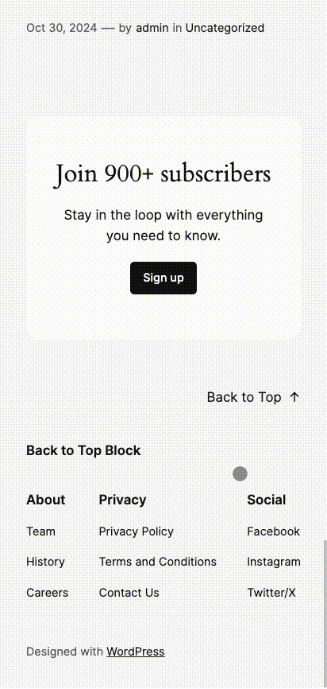
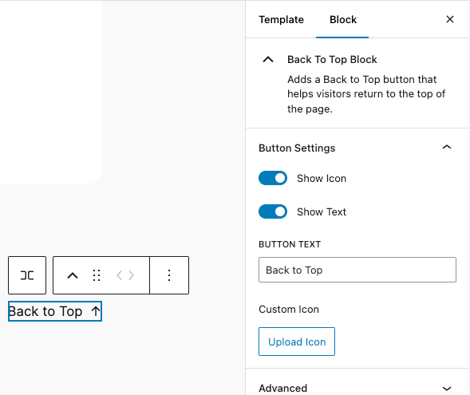

# Back to Top Block

[](https://github.com/philhoyt/Back-to-Top-Block/actions/workflows/ci.yml)
[](https://playground.wordpress.net/?blueprint-url=https://raw.githubusercontent.com/philhoyt/Back-to-Top-Block/main/_playground/blueprint.json)


A WordPress block that adds a Back to Top button which scrolls the page to the top when clicked.



The block registers as `backtotop/back-to-top-block`. Place it where you want the button, usually at the end of a long post or in a footer template part. The button is not fixed to the viewport; it scrolls with the page.

## Requirements

- WordPress 6.6 or later
- PHP 7.4 or later

## Installation

1. Upload the plugin files to `/wp-content/plugins/back-to-top-block`, or install it from the WordPress plugins screen.
2. Activate the plugin.
3. Add the Back To Top Block in the block editor.

Try it without installing: the Playground badge above loads the `main` branch with demo content.

## Usage



The block settings panel has four controls:

- Show Icon: show or hide the up arrow.
- Show Text: show or hide the button text. Hidden text stays in the markup as screen-reader text.
- Button Text: the label, default "Back to Top", up to 50 characters.
- Add Icon: pick an image from the media library to replace the arrow.

Clicking the button calls `window.scrollTo` with `behavior: 'smooth'`, or `'auto'` when the visitor has `prefers-reduced-motion: reduce` set. When the scroll ends, focus is moved to the theme's `.skip-link` (and blurred) so keyboard focus is back at the top of the document. Browsers without `scrollend` use a timer instead.

The button is a `<button>` with an `aria-label` and a visible focus outline. Color, spacing and typography block supports are enabled.

### Attributes

| Attribute | Type | Default | Notes |
|-----------|------|---------|-------|
| `showIcon` | boolean | `true` | |
| `showText` | boolean | `true` | |
| `buttonText` | string | `"Back to Top"` | Max 50 characters; sanitized with `sanitize_text_field()` |
| `iconUrl` | string | `""` | Must be a relative URL or on the site's own host; anything else is saved as `""` |

### Hooks

`back_to_top_block_args` filters the arguments passed to `register_block_type()`. Attributes are defined in `block.json`; sanitization callbacks are attached through `block_type_metadata_settings`.

Blocks saved before 1.0.4 are migrated through a deprecation in `src/deprecated.js`.

## Development

```bash
composer install
npm install
npm run build
```

- `npm start` runs the webpack watch.
- `npm run build` writes the block to `build/`.
- `npm run lint` runs Stylelint, ESLint and PHP CodeSniffer (`npm run lint:css`, `npm run lint:js`, `composer lint` individually).
- `npm run test:unit:js` runs the Jest tests in `src/components/test/`.
- `npm run env:start` starts wp-env; `npm run test:unit:php` then runs PHPUnit inside it.
- `npm run plugin-zip` builds a zip from the `files` list in `package.json`.

CI runs the linters, Jest, the build and PHPUnit on every pull request.

## Releases

Tags are bare version numbers with no `v` prefix. Bump the version in `back-to-top-block.php`, `package.json`, `src/block.json` and `readme.txt`, add a changelog entry, commit, then push the tag:

```bash
git tag 1.0.6 && git push origin 1.0.6
```

The release workflow builds the assets, deploys the plugin to WordPress.org SVN (using `.distignore` to exclude tooling), and creates a GitHub release with the matching changelog section as its body and `readme.txt` attached. The workflow does not attach a zip; the WordPress.org directory serves the installable package.

## Limitations

- The button is placed inline where the block sits. It is not a floating button fixed to the screen.
- Custom icons must be hosted on the same site. An icon URL on another domain is discarded on save.
- Focus restoration after the scroll depends on the theme having a `.skip-link` element. Without one, focus stays on the button.
